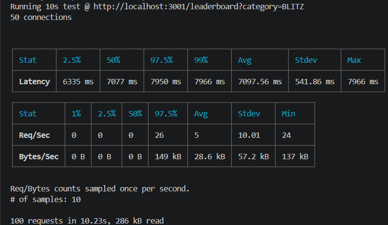
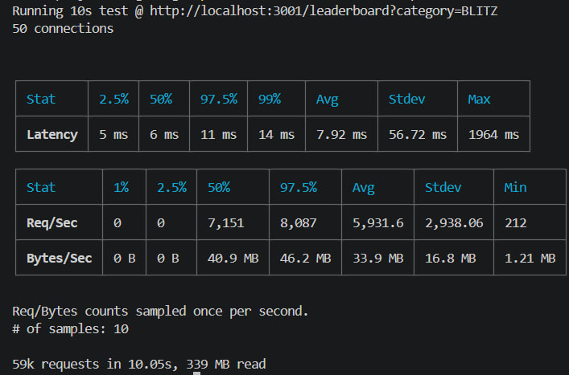

# Performance Benchmark — Leaderboard Cache

## 1. Objective

Measure the impact of Redis caching on the leaderboard endpoint under concurrent load.

## 2. Test Setup

- **Endpoint:** `GET /leaderboard?category=BLITZ`
- **Server:** Local development environment
- **Load tool:** Autocannon
- **Connections:** 50
- **Duration:** 10 seconds
- **Cache TTL:** 30 seconds
- **Cache strategy:** Redis cache-aside with in-process single-flight and TTL jitter

### Command

```bash
npx autocannon -c 50 -d 10 "http://localhost:3001/leaderboard?category=BLITZ"
```

## 3. Results

| Metric                    | Before Cache | After Cache |
| ------------------------- | -----------: | ----------: |
| Requests completed        |          100 |     ~59,000 |
| Throughput (avg. req/sec) |           ~5 |      ~5,932 |
| Average latency           |  7,097.56 ms |     7.92 ms |
| Median latency (p50)      |     7,077 ms |        6 ms |
| p97.5 latency             |     7,950 ms |       11 ms |
| p99 latency               |     7,966 ms |       14 ms |
| Maximum latency           |     7,966 ms |    1,964 ms |

## 4. Analysis

- Average throughput increased from approximately 5 to 5,932 requests/second in this local test.
- Median latency dropped from 7,077 ms to 6 ms.
- p99 latency dropped from 7,966 ms to 14 ms.
- The maximum latency after caching was 1,964 ms, indicating occasional slow requests despite the improved p99 latency.

## 5. Limitations

- These results represent a local benchmark, not a production performance guarantee.
- Results depend on database state, cache warm-up, hardware, and concurrent load.
- Repeat the test under identical conditions to improve reproducibility.
- Verify that responses are successful and correct, and that the after-cache run primarily measures cache hits.




